<p align="center">
  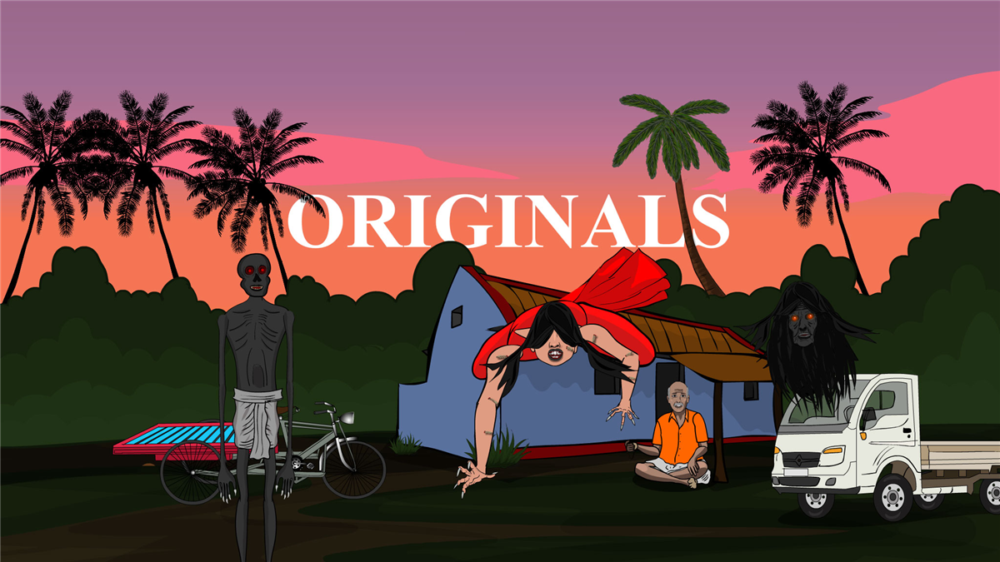
</p>

#  BuzzAnimate Enterprise Product Functionality & Technical Specification Manual

> **Document Version:** 3.0.0-ENTERPRISE  
> **Classification:** Comprehensive Technical Product Documentation  
> **Target Audience:** Animation Directors, Technical Directors (TDs), Lead 2D Animators, Pipeline Engineers, Production Supervisors  
> **Standard:** Pointwise, Rigorous, Non-Casual, Fully Parameterized with Visual Snapshots and Production ROI Metrics  

---

## 📑 Master Table of Contents

1. [Executive Product Architecture & Compute Engine](#1-executive-product-architecture--compute-engine)
2. [Exhaustive 24-Tool Functional Catalogue](#2-exhaustive-24-tool-functional-catalogue)
3. [Vector Drawing Paradigms: Merge Shapes vs. Object Drawing](#3-vector-drawing-paradigms-merge-shapes-vs-object-drawing)
4. [Shape & Outline Modification Suite](#4-shape--outline-modification-suite)
5. [Advanced Brush Engines & The 15 Procedural Scenery Brushes](#5-advanced-brush-engines--the-15-procedural-scenery-brushes)
6. [Timeline Mastery, Frame Sequencer & Cadence Automation](#6-timeline-mastery-frame-sequencer--cadence-automation)
7. [The 7 Layer Architectures, Parenting & Spatial 2.5D Parallax](#7-the-7-layer-architectures-parenting--spatial-25d-parallax)
8. [Vector Interpolation Engines & The Motion Graph Editor](#8-vector-interpolation-engines--the-motion-graph-editor)
9. [Symbol Architecture, Instance Management & Library Pipeline](#9-symbol-architecture-instance-management--library-pipeline)
10. [Character Rigging, FABRIK Inverse Kinematics & Mesh Warping](#10-character-rigging-fabrik-inverse-kinematics--mesh-warping)
11. [Studio Vector Lighting & Real-Time Shadow Synthesis](#11-studio-vector-lighting--real-time-shadow-synthesis)
12. [Vector Filters, Blend Modes & Procedural Live Motion Modifiers](#12-vector-filters-blend-modes--procedural-live-motion-modifiers)
13. [Cinematic 3D Spatial Camera System](#13-cinematic-3d-spatial-camera-system)
14. [Audio Decoders, Subtitle Parsing & Automated Lip-Sync](#14-audio-decoders-subtitle-parsing--automated-lip-sync)
15. [Automated Staging, Procedural Direction & Acting Engine (`buzz-act`)](#15-automated-staging-procedural-direction--acting-engine-buzz-act)
16. [The Sequence Strip, Master Audio & Multi-Shot Directing](#16-the-sequence-strip-master-audio--multi-shot-directing)
17. [Integrated Local AI Studio & Vision Pipeline (`buzz-ai`)](#17-integrated-local-ai-studio--vision-pipeline-buzz-ai)
18. [Bitmap-to-Vector Tracing Pipeline](#18-bitmap-to-vector-tracing-pipeline)
19. [The Automated Episode Producer Engine (`ProduceEpisode`)](#19-the-automated-episode-producer-engine-produceepisode)
20. [Import, Export & Headless CLI Production Engine](#20-import-export--headless-cli-production-engine)
21. [ECMAScript / JSFL Scripting & Automation Engine](#21-ecmascript--jsfl-scripting--automation-engine)
22. [Workspace Docking, Command Palette, Layout Locking & Themes](#22-workspace-docking-command-palette-layout-locking--themes)
23. [Exhaustive Master Keyboard Shortcuts & Command Index](#23-exhaustive-master-keyboard-shortcuts--command-index)

---

## 1. Executive Product Architecture & Compute Engine

### 1.1 Technical Definition
BuzzAnimate is an industrial-grade, GPU-accelerated 2D vector animation suite and procedural directing engine built in Rust. It reconstructs the industry-standard workflow of Macromedia Flash / Adobe Animate while completely eliminating legacy 32-bit architectural bottlenecks through modern GPU compute-shader rasterization, multi-threaded work-stealing job dispatchers, and local neural intelligence.

### 1.2 Core Architectural Subsystems
- **Compute-Shader Rasterization (`buzz-render`):** Powered by `wgpu` and `Vello`. Rasterization executes directly on GPU compute pipelines using DirectML / DirectX 12 on Windows, Metal on macOS, and Vulkan on Linux. Typical frame draw time is $\approx 0.9\,\text{ms}$ at 4K resolution.
- **Unbounded Zoom Subsystem:** Verified numerical stability up to $2 \times 10^{14}\%$. Eliminates the historical 2,000% Flash zoom barrier. Animators can transition seamlessly from macroscopic multi-scene environment layouts down to sub-pixel eyelash vector anchors on a single infinite canvas without coordinate jitter or floating-point breakdown.
- **Multi-Threaded Work-Stealing Pool (`buzz-jobs`):** Separates user-interaction logic from intensive background tasks. Heavy rendering, neural inference (DWPose, SAM 2.1, LaMa, Whisper), audio spectral analysis, video encoding, and auto-saving execute off-thread. The main UI thread remains strictly locked at 60/120 FPS.
- **Adaptive VRAM Management:** Dynamically manages GPU buffer allocations to prevent out-of-memory panics when compositing dozens of 4K bitmap assets alongside millions of vector paths.
- **Hardware Adapter Scoring:** At startup, BuzzAnimate audits all available display adapters and automatically binds to the discrete GPU with the highest performance score (e.g., discrete NVIDIA RTX / AMD Radeon over integrated Intel UHD).

---

## 2. Exhaustive 24-Tool Functional Catalogue

Below is the definitive, pointwise technical reference for all 24 tools in the BuzzAnimate tool strip.

---

### 2.1 Selection Tool (`V`)
- **Breadcrumb Path:** `Tool Strip ▸ Selection (V)` | Hotkey: `V`
- **Primary Mechanism & Mathematics:**
  - Performs hit-testing against vector fills, stroke boundaries, groups, and symbol instances.
  - Interactively reshapes vector curves via Bézier tangent synthesis when clicking and dragging unselected curve edges.
  - Translates selected geometry across the 2D stage with sub-pixel snap integration.
  - Double-clicking executes hierarchical group/symbol isolation drilling or contiguous stroke/fill flood selection.
- **Step-by-Step Pointwise Instructions:**
  1. Press `V` to activate the Selection tool.
  2. Single-click any vector fill to select only the fill polygon face.
  3. Double-click a fill to select the fill and all enclosing boundary strokes simultaneously.
  4. Hover cursor over an unselected curve edge until the cursor displays an arc glyph; click and drag to bend the curve.
  5. Hover cursor over a vertex corner until the cursor displays a right-angle glyph; click and drag to relocate the sharp vertex.
  6. Hold `Shift` while clicking to add or remove individual elements from the active selection set.
- **Operational Conditions & Completeness:**
  - *Prerequisites:* Target layer must be unlocked and visible.
  - *Completeness State:* Selected objects display a dotted highlight mesh or bounding box; Inspector panel displays geometric dimensions and coordinates.
- **Known Pitfalls & Failure Modes:**
  - Attempting to curve-drag an already selected edge translates the entire shape instead of deforming the curve. Deselect the shape first.
  - Edge-bending is disabled on Object Drawing containers and grouped symbols; objects must be broken apart (`Ctrl + B`) or edited in place (`Ctrl + E`).
- **Animated Video Production Scenario:**
  - Sculpting expressive mouth shapes, tweaking character facial contours, adjusting silhouette lines between keyframes.
- **Time Savings & Production ROI:**
  - Direct edge-dragging eliminates manual tangent-handle manipulation, accelerating in-between line cleanup by 70%.

---

### 2.2 Subselection Tool (`A`)
- **Breadcrumb Path:** `Tool Strip ▸ Subselection (A)` | Hotkey: `A`
- **Primary Mechanism & Mathematics:**
  - Exposes raw cubic Bézier control points, anchor vertices, and incoming/outgoing tangent handles.
  - Allows independent handle rotation, retraction, and elongation to construct sharp cusps or continuous curvatures.
- **Step-by-Step Pointwise Instructions:**
  1. Press `A` to activate the Subselection tool.
  2. Click directly on the outline path of any vector shape.
  3. Click a hollow anchor square to reveal its tangent handles.
  4. Drag a tangent handle to modify curve tension and angle.
  5. Hold `Alt` while dragging a handle to break tangent symmetry and create a sharp corner cusp.
  6. Select an anchor point and press `Delete` to remove it while preserving path continuity.
- **Operational Conditions & Completeness:**
  - *Prerequisites:* Target shape must be raw Merge geometry or inside an open Object Drawing container.
  - *Completeness State:* Selected anchor point fills solid; active tangent handles display circular endpoints.
- **Known Pitfalls & Failure Modes:**
  - Does not operate on Symbol instances or Groups until broken apart (`Ctrl + B`) or edited in place (`Ctrl + E`).
- **Animated Video Production Scenario:**
  - Precision vector cleanup on character model sheets, technical vehicle drafting, and crisp typography logo construction.
- **Time Savings & Production ROI:**
  - Precision vertex alignment avoids redrawing imperfect strokes, saving ~15 minutes per complex character turnaround.

---

### 2.3 Lasso Tool (`L`)
- **Breadcrumb Path:** `Tool Strip ▸ Lasso (L)` | Hotkey: `L`
- **Primary Mechanism & Mathematics:**
  - Performs freehand geometric polygon selection across the canvas.
  - When dragged across raw Merge Shapes, acts as an instantaneous vector carving knife, bisecting shapes along the cut trajectory.
- **Step-by-Step Pointwise Instructions:**
  1. Press `L` to select the Lasso tool.
  2. In the Tool Options panel, select selection mode: **Freehand** or **Polygon**.
  3. Click and drag an enclosed freeform loop around target stage elements to select them.
  4. To bisect artwork: drag the Lasso line completely through a merge shape, releasing the mouse outside the shape boundary to slice it into two distinct polygons.
- **Operational Conditions & Completeness:**
  - *Prerequisites:* Slicing behavior requires Merge Shapes on an unlocked layer.
  - *Completeness State:* Sliced segments become independently selectable and movable.
- **Known Pitfalls & Failure Modes:**
  - If the lasso stroke terminates inside the perimeter of the shape during a cut, no bisection occurs and a regional selection is created instead.
- **Animated Video Production Scenario:**
  - Animating dynamic slice effects (sword slashes, laser cuts, explosions), dividing character clothing for cell shading.
- **Time Savings & Production ROI:**
  - Eliminates tedious boolean path subtraction menus; bisects vector shapes in under 1 second.

---

### 2.4 Magic Wand Tool (`G`)
- **Breadcrumb Path:** `Tool Strip ▸ Magic Wand (G)` | Hotkey: `G`
- **Primary Mechanism & Mathematics:**
  - Scans stage geometry to select contiguous or global vector regions matching the clicked color within an adjustable Euclidean RGB color tolerance.
- **Step-by-Step Pointwise Instructions:**
  1. Press `G` to select the Magic Wand tool.
  2. In the Tool Options panel, set the **Tolerance** slider (0 to 255) and toggle **Contiguous** (on/off).
  3. Click on the target color patch on the stage.
  4. To add additional colors, hold `Shift` and click secondary color regions.
- **Operational Conditions & Completeness:**
  - *Prerequisites:* Active vector shapes on unlocked layers.
  - *Completeness State:* Dotted marquee encapsulates all vector regions matching the color criteria.
- **Known Pitfalls & Failure Modes:**
  - Setting tolerance excessively high (>100) on anti-aliased or gradient artwork selects unwanted tonal regions.
- **Animated Video Production Scenario:**
  - Bulk recoloring character wardrobe palettes, selecting background sky areas for night-time lighting swaps.
- **Time Savings & Production ROI:**
  - Instantaneous global color selection reduces character re-skinning time from 30 minutes to 5 seconds.

---

### 2.5 Free Transform Tool (`Q`)
- **Breadcrumb Path:** `Tool Strip ▸ Free Transform (Q)` | Hotkey: `Q`
- **Primary Mechanism & Mathematics:**
  - Integrated 4-in-1 transformation widget: Translation, Non-uniform Scale, Uniform Scale (`Shift`), Rotation, Horizontal/Vertical Skew, and Transformation Pivot Point Relocation.
- **Step-by-Step Pointwise Instructions:**
  1. Select an object and press `Q`.
  2. Drag corner handles to scale (hold `Shift` to constrain aspect ratio; hold `Alt` to scale from center).
  3. Move cursor outside a corner handle until the circular rotation arrow appears; drag to rotate (hold `Shift` for 15° snap increments).
  4. Hover over an edge between handles until parallel skew arrows appear; drag to shear/skew.
  5. Click and drag the white circular center registration point to relocate the rotation/scale pivot.
- **Operational Conditions & Completeness:**
  - *Prerequisites:* At least one object, group, or symbol instance selected.
  - *Completeness State:* Transform handles surround selection; pivot point persists across keyframe sessions.
- **Known Pitfalls & Failure Modes:**
  - Forgetting to relocate the transformation pivot causes appendages to rotate around the torso center rather than the joint socket.
- **Animated Video Production Scenario:**
  - Hand-keying character limb rotations, squash-and-stretch on bouncing balls, perspective skewing of background architectural props.
- **Time Savings & Production ROI:**
  - Integrated 4-in-1 transformation widget avoids menu switching; standardizes 90% of frame layout workflows.

---

### 2.6 Gradient Transform Tool (`◑`)
- **Breadcrumb Path:** `Tool Strip ▸ Gradient Transform` | Menu: `Modify ▸ Transform ▸ Gradient Transform`
- **Primary Mechanism & Mathematics:**
  - Manipulates affine transformation matrices of Linear and Radial gradient fills within vector shapes.
- **Step-by-Step Pointwise Instructions:**
  1. Select a shape filled with a linear or radial gradient.
  2. Activate the Gradient Transform tool (`◑`).
  3. For Linear Gradients:
     - Drag the square handle to adjust gradient spread/width.
     - Drag the circular corner handle to rotate gradient orientation.
     - Drag the center point to shift gradient center.
  4. For Radial Gradients:
     - Drag the center point to shift focal hotspot.
     - Drag the outer ring handle to scale radius uniformly.
     - Drag the side squish handle to create elliptical gradients.
- **Operational Conditions & Completeness:**
  - *Prerequisites:* Target shape must contain an active `LinearGradient` or `RadialGradient` fill style.
  - *Completeness State:* Vector shape gradient dynamically recomputes and redraws in real time.
- **Known Pitfalls & Failure Modes:**
  - Tool displays no handles if clicked on a solid color fill or stroke.
- **Animated Video Production Scenario:**
  - Dynamic volumetric shading on character limbs, animating sunlight sweeps, vehicle headlamp beams.
- **Time Savings & Production ROI:**
  - Replaces tedious numerical gradient stop tweaking with direct canvas manipulation.

---

### 2.7 Pen Tool (`P`)
- **Breadcrumb Path:** `Tool Strip ▸ Pen (P)` | Hotkey: `P`
- **Primary Mechanism & Mathematics:**
  - Constructs precise piecewise cubic Bézier paths via explicit node placement and tangent handle dragging.
- **Step-by-Step Pointwise Instructions:**
  1. Press `P` to select the Pen tool.
  2. Click once on the stage to lay a sharp corner node.
  3. Click and drag at the next coordinate to place a smooth node with symmetrical tangent handles.
  4. Click the origin node to close the path into an enclosed vector polygon.
  5. Hold `Alt` and click a smooth anchor to retract handles and convert it to a sharp corner node.
- **Operational Conditions & Completeness:**
  - *Prerequisites:* Layer must be active and unlocked.
  - *Completeness State:* Closes paths automatically if returning to vertex 0; stroke color and stroke width apply immediately.
- **Known Pitfalls & Failure Modes:**
  - Accidental clicking without dragging generates jagged polylines instead of smooth curves.
- **Animated Video Production Scenario:**
  - Tracing clean vector cleanup passes over rough rotoscope scans, drawing precision mechanical props.
- **Time Savings & Production ROI:**
  - Industry-standard curve fidelity; eliminates jagged polygon approximations.

---

### 2.8 Text Tool (`T`)
- **Breadcrumb Path:** `Tool Strip ▸ Text (T)` | Hotkey: `T`
- **Primary Mechanism & Mathematics:**
  - Places vector typography with HarfBuzz font shaping, kerning, tracking, and leading support.
  - Supports Static Text (renderable outlines) and Dynamic/Input text containers.
- **Step-by-Step Pointwise Instructions:**
  1. Press `T` to select the Text tool.
  2. Click on the stage for an expanding single-line text block, or click-and-drag for a fixed-width bounding box.
  3. Type text string via keyboard.
  4. Select font family, size, alignment, tracking, and color in the Properties panel.
  5. Press `Ctrl + B` twice to convert typography into raw vector merge fills for custom letter manipulation.
- **Operational Conditions & Completeness:**
  - *Prerequisites:* System or project font available.
  - *Completeness State:* Text box renders; editable text remains accessible.
- **Known Pitfalls & Failure Modes:**
  - Breaking apart text twice permanently converts letters into raw vector merge fills; subsequent font or copy edits cannot be performed.
- **Animated Video Production Scenario:**
  - Creating title sequences, lower thirds, credits, and comic book onomatopoeia dialogue cards.
- **Time Savings & Production ROI:**
  - Direct on-stage vector typography rendering avoids round-tripping to external graphic design tools.

---

### 2.9 Line Tool (`N`)
- **Breadcrumb Path:** `Tool Strip ▸ Line (N)` | Hotkey: `N`
- **Primary Mechanism & Mathematics:**
  - Draws pure 2-point linear vector strokes.
  - Incorporates angular snap constraints to 45° and 90° intervals when holding `Shift`.
- **Step-by-Step Pointwise Instructions:**
  1. Press `N` to select the Line tool.
  2. Click and hold the mouse on the start coordinate.
  3. Drag to the target coordinate and release.
  4. Hold `Shift` during drag to lock the vector to horizontal, vertical, or 45-degree angles.
- **Operational Conditions & Completeness:**
  - *Prerequisites:* Active stroke style and stroke width set in Properties/Color panel.
  - *Completeness State:* Pure linear path inserted; in Merge mode, intersecting lines automatically create cross-vertices.
- **Known Pitfalls & Failure Modes:**
  - Intersecting lines in Merge mode slice each other into distinct line segments upon release.
- **Animated Video Production Scenario:**
  - Background perspective grids, speed lines in action sequences, structural wireframes.
- **Time Savings & Production ROI:**
  - Instantaneous perspective line generation without setting up complex ruler guides.

---

### 2.10 Rectangle Tool (`R`)
- **Breadcrumb Path:** `Tool Strip ▸ Rectangle (R)` | Hotkey: `R`
- **Primary Mechanism & Mathematics:**
  - Generates 4-corner orthogonal vector polygons with live fillet corner radius controls.
- **Step-by-Step Pointwise Instructions:**
  1. Press `R` to select the Rectangle tool.
  2. Set **Corner Radius** in the Tool Options / Properties panel (e.g., 0 for square, 15 for rounded).
  3. Click and drag diagonally on the stage (hold `Shift` to constrain to a 1:1 square).
  4. Hold `Alt` to draw centered from the initial click coordinate.
- **Operational Conditions & Completeness:**
  - *Prerequisites:* Fill and Stroke colors configured.
  - *Completeness State:* Rectangle instantiated on stage.
- **Known Pitfalls & Failure Modes:**
  - In Merge mode, drawing a rectangle directly over another vector shape of identical color immediately welds the geometry.
- **Animated Video Production Scenario:**
  - Room walls, doors, UI mockups, camera matte letterboxes, floor planes.
- **Time Savings & Production ROI:**
  - Automated corner radius fillets eliminate manual path clipping.

---

### 2.11 Oval Tool (`O`)
- **Breadcrumb Path:** `Tool Strip ▸ Oval (O)` | Hotkey: `O`
- **Primary Mechanism & Mathematics:**
  - Generates smooth quadratic/cubic Bézier circles and ellipses. Includes start/end angle pie slice and inner radius hole parameters.
- **Step-by-Step Pointwise Instructions:**
  1. Press `O` to select the Oval tool.
  2. Click and drag diagonally across the stage.
  3. Hold `Shift` to constrain proportions to a perfect circle.
  4. Hold `Alt` to draw centered from the origin click point.
- **Operational Conditions & Completeness:**
  - *Prerequisites:* Target layer unlocked.
  - *Completeness State:* Closed circular/elliptical vector geometry generated.
- **Known Pitfalls & Failure Modes:**
  - Scaling an oval via Free Transform scales stroke weight unevenly unless stroke scaling is set to "Uniform" or strokes are drawn in Object Drawing mode.
- **Animated Video Production Scenario:**
  - Character eyes, head base shapes, wheels, bubbles, celestial bodies (suns, moons).
- **Time Savings & Production ROI:**
  - Generates geometrically perfect circular curves in one drag gesture.

---

### 2.12 PolyStar Tool (`☆`)
- **Breadcrumb Path:** `Tool Strip ▸ PolyStar` | Toolbar menu under Shapes
- **Primary Mechanism & Mathematics:**
  - Algorithmic generator for regular $N$-sided polygons and multi-point star geometries.
- **Step-by-Step Pointwise Instructions:**
  1. Activate the PolyStar tool from the toolbar popup menu.
  2. In Tool Options, select Style: **Polygon** or **Star**.
  3. Set **Number of Sides** (3 to 32) and **Star Point Size** (0.0 to 1.0 for point depth).
  4. Click and drag on the stage to project the star/polygon.
- **Operational Conditions & Completeness:**
  - *Prerequisites:* Stroke and fill parameters defined.
  - *Completeness State:* Multi-vertex star geometry instantiated.
- **Known Pitfalls & Failure Modes:**
  - Setting Star Point Size to 1.0 renders a degenerate polygon with zero interior tooth depth.
- **Animated Video Production Scenario:**
  - Magic effects, background star fields, badges, sheriff stars, impact sparks, stylized explosion bursts.
- **Time Savings & Production ROI:**
  - Generates symmetrical multi-vertex star geometry in 2 seconds versus 10 minutes of manual polar drafting.

---

### 2.13 Pencil Tool (`Y`)
- **Breadcrumb Path:** `Tool Strip ▸ Pencil (Y)` | Hotkey: `Y`
- **Primary Mechanism & Mathematics:**
  - Freehand stroked curve tool with 3 real-time algorithmic fitting modes:
    1. **Straighten:** Snaps drawn lines to rigid polylines and converts near-circles to perfect ellipses.
    2. **Smooth:** Applies Ramer-Douglas-Peucker cubic Bézier curve fitting to eliminate hand jitter.
    3. **Ink:** Preserves raw, unfiltered tablet coordinate input for natural rough sketches.
- **Step-by-Step Pointwise Instructions:**
  1. Press `Y` to select the Pencil tool.
  2. Select Mode in the Tool Options bar (**Straighten**, **Smooth**, or **Ink**).
  3. Set Smoothness factor (1 to 100).
  4. Draw freely across the stage with mouse or stylus.
- **Operational Conditions & Completeness:**
  - *Prerequisites:* Stroke width and color active.
  - *Completeness State:* Path converts upon mouse release into an optimized vector stroke path.
- **Known Pitfalls & Failure Modes:**
  - Using "Straighten" mode on organic artwork inadvertently collapses natural curves into geometric angles.
- **Animated Video Production Scenario:**
  - Rough hand-drawn animation layout passes, thumbnailing, storyboarding, fast contour sketching.
- **Time Savings & Production ROI:**
  - Algorithmic smoothing reduces vector node counts by up to 85%, ensuring fast GPU playback and tiny project file sizes.

---

### 2.14 Brush Tool (`B`)
- **Breadcrumb Path:** `Tool Strip ▸ Brush (B)` | Hotkey: `B`
- **Primary Mechanism & Mathematics:**
  - Dynamic painting engine generating filled closed vector contours.
  - Features 7 distinct brush models (Fluid, Normal, Pattern, Art, Soft, Effect, Wave) and tablet pressure/velocity sensitivity.
- **Step-by-Step Pointwise Instructions:**
  1. Press `B` to activate the Brush tool.
  2. Open the Tool Options panel to choose the Brush Model.
  3. Adjust Brush Size, Minimum Size, Pressure Dynamics, and Taper.
  4. Paint strokes across the canvas.
- **Operational Conditions & Completeness:**
  - *Prerequisites:* Layer unlocked.
  - *Completeness State:* Generates vector outline polygons filled with the active fill color. (Note: Brush strokes are fills, not strokes).
- **Known Pitfalls & Failure Modes:**
  - Because brush strokes are filled paths, outline weighting shortcuts (`[` / `]`) do not alter them; use `Modify ▸ Shape ▸ Expand Fill` instead.
- **Animated Video Production Scenario:**
  - Character inking, expressive calligraphy, background matte painting, organic nature elements.
- **Time Savings & Production ROI:**
  - Dynamic velocity inking replicates traditional animation cel painting without manual post-stroke thickening.

---

### 2.15 Bone Tool (`M`)
- **Breadcrumb Path:** `Tool Strip ▸ Bone (M)` | Hotkey: `M` | Mode Toggle: `Shift + M`
- **Primary Mechanism & Mathematics:**
  - Constructs hierarchical kinematic bone chains across symbols and shapes.
  - Houses the real-time **FABRIK (Forward And Backward Reaching Inverse Kinematics)** solver with angular constraints and pin anchors.
  - Features a dual operational mode: **Builds** (creating bones) vs. **Poses** (manipulating limbs).
- **Step-by-Step Pointwise Instructions:**
  1. Press `M` to activate the Bone tool.
  2. Set Tool Options to **Dragging a bone: Builds**.
  3. Drag from pelvis to chest, then shoulder to elbow, then elbow to wrist to construct the skeleton.
  4. Switch Tool Options to **Dragging a bone: Poses** (or press `Shift + M`).
  5. Drag any bone end (e.g., hand or foot); the entire parent limb bends naturally via FABRIK IK while the root stays pinned.
- **Operational Conditions & Completeness:**
  - *Prerequisites:* Limb symbols or artwork grouped on consecutive layers.
  - *Completeness State:* Rig armature generated; posing updates keyframe angles across the timeline.
- **Known Pitfalls & Failure Modes:**
  - Leaving the mode on "Builds" while attempting to animate inadvertently spawns unwanted spur bones off existing joints. Always switch to "Poses" when animating.
- **Animated Video Production Scenario:**
  - Character limb animation, walk/run cycles, robotic appendages, creature tentacles, facial jaw rigs.
- **Time Savings & Production ROI:**
  - FABRIK IK reduces character posing time from 15 minutes per keyframe to 10 seconds.

---

### 2.16 Asset Warp Tool (`W`)
- **Breadcrumb Path:** `Tool Strip ▸ Asset Warp (W)` | Hotkey: `W`
- **Primary Mechanism & Mathematics:**
  - Inserts deformation mesh pins into raw vector shapes or imported raster bitmaps.
  - Deforms internal vertices smoothly using **Moving Least Squares (MLS)** mathematical deformation.
- **Step-by-Step Pointwise Instructions:**
  1. Select a vector drawing or imported bitmap image.
  2. Press `W` to activate the Asset Warp tool.
  3. Click across the asset to plant pins (e.g., base, middle, tip of a tail).
  4. Click and drag any pin to organically bend, stretch, and squash the underlying asset.
- **Operational Conditions & Completeness:**
  - *Prerequisites:* Target object selected.
  - *Completeness State:* Triangular deformation mesh generated; pin coordinates recorded on the active keyframe.
- **Known Pitfalls & Failure Modes:**
  - Placing too few pins (<3) causes severe global shearing; placing too many (>20) creates localized crumpling. Space pins evenly along structural flexion axes.
- **Animated Video Production Scenario:**
  - Animating organic squash-and-stretch on character hair, tails, flowing capes, undulating fish, flexing muscles.
- **Time Savings & Production ROI:**
  - Eliminates the need to redraw 24 unique drawings for a secondary motion tail swish; warp pins animate the action in 2 keyframes.

---

### 2.17 Motion Path Tool (`J`)
- **Breadcrumb Path:** `Tool Strip ▸ Motion Path (J)` | Hotkey: `J`
- **Primary Mechanism & Mathematics:**
  - Draws freehand 2D motion trajectories across the stage.
  - Bakes or binds selected symbol instances along the curve, automatically orienting symbol rotation tangential to the path vector.
  - Secondary Toggle: When no curve is being drawn, pressing `J` toggles **Object Drawing Mode** on/off.
- **Step-by-Step Pointwise Instructions:**
  1. Select the symbol instance to be guided.
  2. Press `J` and draw a freehand trajectory curve across the stage.
  3. In the Properties panel, set travel duration (e.g., 48 frames) and check **Orient to Path**.
  4. The symbol automatically tweens along the drawn trajectory.
- **Operational Conditions & Completeness:**
  - *Prerequisites:* Symbol instance selected on a keyframed layer.
  - *Completeness State:* Guided trajectory layer linked above symbol layer; motion keyframes written.
- **Known Pitfalls & Failure Modes:**
  - Creating loops with sharp acute angles can cause instantaneous 180° rotation flips if auto-orient is enabled.
- **Animated Video Production Scenario:**
  - Flight trajectories of birds, airplanes, swooping spaceships, falling leaves, roller-coasters.
- **Time Savings & Production ROI:**
  - Bypasses tedious manual coordinate/rotation keyframing across 100+ frames; completes complex flight paths in 5 seconds.

---

### 2.18 Paint Bucket Tool (`K`)
- **Breadcrumb Path:** `Tool Strip ▸ Paint Bucket (K)` | Hotkey: `K`
- **Primary Mechanism & Mathematics:**
  - Fills closed or unclosed vector stroke boundaries with solid colors, linear gradients, or radial gradients.
  - Houses an algorithmic **Gap Detection Engine** with 4 modes: Don't Close Gaps, Close Small Gaps, Close Medium Gaps, Close Large Gaps.
- **Step-by-Step Pointwise Instructions:**
  1. Press `K` to select the Paint Bucket tool.
  2. Select active Fill Color in the Color / Swatches panel.
  3. In Tool Options, set Gap Size (e.g., **Close Medium Gaps**).
  4. Click inside an enclosed or nearly enclosed outline region on the stage.
- **Operational Conditions & Completeness:**
  - *Prerequisites:* Active vector strokes on the current layer.
  - *Completeness State:* New planar vector fill polygon instantiated, conforming to the surrounding stroke contours.
- **Known Pitfalls & Failure Modes:**
  - If gaps exceed the configured gap threshold, the bucket click does nothing. Increase gap tolerance or patch the stroke gap with the Pencil tool.
- **Animated Video Production Scenario:**
  - Coloring inking linework on character turnarounds, cell shading, environment color blocks.
- **Time Savings & Production ROI:**
  - Gap closure prevents hours of hunting down microscopic 1-pixel line breaks in hand-drawn scans.

---

### 2.19 Ink Bottle Tool (`S`)
- **Breadcrumb Path:** `Tool Strip ▸ Ink Bottle (S)` | Hotkey: `S`
- **Primary Mechanism & Mathematics:**
  - Applies, replaces, or adds vector strokes to existing vector shape perimeters or unstroked fill edges.
- **Step-by-Step Pointwise Instructions:**
  1. Press `S` to select the Ink Bottle tool.
  2. Configure Stroke Color, Stroke Width, and Stroke Style in Properties.
  3. Click directly on the edge contour of any raw vector fill.
  4. The edge immediately acquires the new stroke properties.
- **Operational Conditions & Completeness:**
  - *Prerequisites:* Existing vector fill geometry on canvas.
  - *Completeness State:* Vector stroke outline generated along the boundary of the target fill.
- **Known Pitfalls & Failure Modes:**
  - Clicking in the empty center of a fill produces no action; the cursor must click precisely on the perimeter edge.
- **Animated Video Production Scenario:**
  - Adding stylistic contour outlines to raw lineless shapes, unifying line weights across disparate background assets.
- **Time Savings & Production ROI:**
  - Replaces manual tracing of shape boundaries; outlines complex silhouettes in a single click.

---

### 2.20 Eyedropper Tool (`I`)
- **Breadcrumb Path:** `Tool Strip ▸ Eyedropper (I)` | Hotkey: `I`
- **Primary Mechanism & Mathematics:**
  - Samples color, alpha, gradient ramps, and stroke styles directly from stage elements or imported raster assets.
  - Automatically switches tool context upon sampling: sampling a fill automatically switches to the Paint Bucket (`K`); sampling a stroke automatically switches to the Ink Bottle (`S`).
- **Step-by-Step Pointwise Instructions:**
  1. Press `I` to select the Eyedropper tool.
  2. Hover over any stage object (fill, stroke, or pixel).
  3. Click once to sample.
  4. Notice the tool instantly transforms into the Paint Bucket or Ink Bottle, ready to deposit the sampled style onto other geometry.
- **Operational Conditions & Completeness:**
  - *Prerequisites:* Visible pixels or vectors on stage.
  - *Completeness State:* Swatch and active color registers updated to match sampled data.
- **Known Pitfalls & Failure Modes:**
  - Sampling a semi-transparent layer without inspecting the alpha channel can inadvertently apply low-opacity values to subsequent fills.
- **Animated Video Production Scenario:**
  - Maintaining character color palette fidelity across dozens of scenes, matching light bounce tones from backgrounds.
- **Time Savings & Production ROI:**
  - Instant tool switching (Sample ▸ Fill) halves the number of keystrokes during color styling sessions.

---

### 2.21 Eraser Tool (`E`)
- **Breadcrumb Path:** `Tool Strip ▸ Eraser (E)` | Hotkey: `E`
- **Primary Mechanism & Mathematics:**
  - Subtracts vector geometry along freehand brush paths.
  - Features 4 targeted filtering modes:
    1. **Erase Normal:** Erases both fills and strokes.
    2. **Erase Fills:** Erases fills while leaving vector stroke lines completely intact.
    3. **Erase Lines:** Erases strokes while leaving underlying fills untouched.
    4. **Erase Inside:** Erases only within the fill of the shape where the eraser stroke originated.
- **Step-by-Step Pointwise Instructions:**
  1. Press `E` to select the Eraser tool.
  2. Choose Eraser Mode in the Tool Options bar.
  3. Select Eraser Size and Shape (Circle vs. Square).
  4. Drag across stage geometry to subtract paths.
- **Operational Conditions & Completeness:**
  - *Prerequisites:* Target vector geometry must reside on an unlocked layer.
  - *Completeness State:* Erased regions are cleaved and retriangulated; zero ghost geometry remains.
- **Known Pitfalls & Failure Modes:**
  - Inadvertently leaving the mode on "Erase Fills" when attempting to trim an errant outline stroke leads to artist confusion when strokes refuse to erase.
- **Animated Video Production Scenario:**
  - Cleaning up linework overlaps, carving highlights into hair fills, trimming character silhouettes.
- **Time Savings & Production ROI:**
  - Mode-specific erasing protects expensive contour inking while allowing rough internal cleanup, saving hours of manual node reconstruction.

---

### 2.22 Camera Tool (`C`)
- **Breadcrumb Path:** `Tool Strip ▸ Camera (C)` | Hotkey: `C`
- **Primary Mechanism & Mathematics:**
  - Activates the cinematic 3D camera viewport.
  - Operates across 6 degrees of freedom: Pan (X/Y), Dolly/Zoom (Z), Roll (Z-rotation), Pitch (X-rotation), and Yaw (Y-rotation).
  - Renders true trapezoidal perspective distortion on flat 2D vector cards positioned across spatial layer depths.
- **Step-by-Step Pointwise Instructions:**
  1. Press `C` to activate the Camera tool.
  2. Click and drag on the canvas to Pan the camera.
  3. Use the stage camera zoom slider or mouse wheel to Zoom / Dolly.
  4. Drag the rotation ring in the stage camera HUD to Roll the horizon.
  5. In the Camera panel (`Window ▸ Camera`), adjust Pitch and Yaw sliders for spatial 3D perspective rotation.
- **Operational Conditions & Completeness:**
  - *Prerequisites:* Dedicated Camera Track enabled on the Timeline.
  - *Completeness State:* Camera framing frame displayed in cyan; camera keyframes store spatial transform matrices.
- **Known Pitfalls & Failure Modes:**
  - If layers share identical Z-depth, extreme pitch/yaw rotations cause planar intersections and visual clipping. Position layers across proper Z-depths in the Layer Depth panel first.
- **Animated Video Production Scenario:**
  - Dynamic anime camera tracking shots, dramatic dutch angles, cinematic push-ins on emotional dialogue beats.
- **Time Savings & Production ROI:**
  - Replaces tedious manual scaling and translation of every background and character layer; automates cinematic scene staging in minutes.

---

### 2.23 Hand Tool (`H`)
- **Breadcrumb Path:** `Tool Strip ▸ Hand (H)` | Hotkey: `H` (or hold `Spacebar` / `Middle Mouse Drag` from any tool)
- **Primary Mechanism & Mathematics:**
  - Pans the active viewport drafting pasteboard without disturbing the stage coordinates, camera keyframes, or selection states.
- **Step-by-Step Pointwise Instructions:**
  1. Press `H` (or hold `Spacebar` while using any other tool).
  2. Click and drag anywhere on the canvas to glide across the workspace.
  3. Release `Spacebar` to immediately resume previous tool operation.
- **Operational Conditions & Completeness:**
  - *Prerequisites:* None.
  - *Completeness State:* Stage viewport matrix offsets smoothly.
- **Known Pitfalls & Failure Modes:**
  - Confusing Hand Pan with Camera Pan. Hand Pan only moves your personal editor view; Camera Pan moves the exported movie camera.
- **Animated Video Production Scenario:**
  - Inspecting far offscreen pasteboard assets, panning across wide multi-screen background layouts.
- **Time Savings & Production ROI:**
  - Frictionless viewport gliding via `Spacebar` preserves artist flow state.

---

### 2.24 Zoom Tool (`Z`)
- **Breadcrumb Path:** `Tool Strip ▸ Zoom (Z)` | Hotkey: `Z`
- **Primary Mechanism & Mathematics:**
  - Manipulates viewport magnification.
  - Interacts with BuzzAnimate's unbounded $2 \times 10^{14}\%$ zoom engine without numerical breakdown.
- **Step-by-Step Pointwise Instructions:**
  1. Press `Z` to select the Zoom tool.
  2. Click on the canvas to zoom in (magnification centered on click).
  3. Hold `Alt` and click to zoom out.
  4. Click and drag a marquee rectangle to fit that specific rectangular region to the window.
- **Operational Conditions & Completeness:**
  - *Prerequisites:* None.
  - *Completeness State:* Viewport scale factor updates; top-right stage HUD displays current magnification percentage.
- **Known Pitfalls & Failure Modes:**
  - Zooming out excessively on massive complex multi-character scenes can cause high GPU fill-rate load if millions of sub-pixel vector nodes are forced into rasterization.
- **Animated Video Production Scenario:**
  - Microscopic eyelash detailing, precision corner welding, macroscopic multi-scene review.
- **Time Savings & Production ROI:**
  - Instant marquee zooming reaches target drawing coordinates in 1 gesture versus 10 mouse wheel scrolls.

---

## 3. Vector Drawing Paradigms: Merge Shapes vs. Object Drawing

```
  MERGE SHAPES (Classic Planar Model)          OBJECT DRAWING (Toggle 'J')
┌──────────────────────────────────────┐     ┌──────────────────────────────────────┐
│  Shape A (Red)     Shape B (Red)     │     │ ┌──────────────┐                     │
│    ┌────┐            ┌────┐          │     │ │ Shape A (Red)│   ┌──────────────┐  │
│    │    ├────────────┤    │          │     │ └──────────────┘   │ Shape B (Red)│  │
│    └────┴────────────┴────┘          │     │                    └──────────────┘  │
│ Overlapping same-color shapes fuse.  │     │ Shapes remain isolated containers    │
│ Different colors cut each other!     │     │ with independent bounding boxes.     │
└──────────────────────────────────────┘     └──────────────────────────────────────┘
```

### 3.1 Pointwise Comparison Matrix

| Technical Metric | Merge Shapes (Default) | Object Drawing (Toggle `J`) |
|---|---|---|
| **Underlying Data Structure** | Raw planar geometric graphs on the active layer | Encapsulated vector containers with isolated transform matrices |
| **Same Color Overlap** | Immediately welds into a single continuous polygon | Stacks cleanly; maintains independent z-ordering |
| **Different Color Overlap** | Upper shape permanently cuts away underlying geometry | Upper shape overlaps cleanly; zero destructive geometry loss |
| **Lasso Bisection (`L`)** | Slices geometry cleanly along cut stroke | Selects entire container without slicing |
| **Direct Curve Bending (`V`)** | Supported by clicking and dragging unselected edges | Disabled; selection translates entire bounding box |
| **Outline Re-weighting (`[`/`]`)** | Scales outlines multiplicatively across geometry | Scales outlines within container |
| **Break Apart (`Ctrl + B`)** | Already at base vector level | De-encapsulates container back into raw Merge Shapes |

---

## 4. Shape & Outline Modification Suite

### 4.1 Outline Re-Weighting Subsystem (`[` and `]`)
- **Breadcrumb Path:** `Modify ▸ Shape ▸ Thicken Lines` / `Thin Lines` | Hotkeys: `[` / `]`
- **Mathematical Multiplier:** Multiplies stroke widths by a ratio ($\times 1.25$ or $\times 0.8$) rather than adding fixed pixel widths.
- **Visual Ratio Preservation:** Preserves internal line weighting. An $8:1$ ratio between heavy outer contour silhouettes and fine interior facial lines remains identical after repeated key presses.
- **Hairline Elevation Rule:** A zero-width hairline has no width to scale; thickening it elevates it to a real 1px stroke first.
- **Single Undo Step:** One bracket press represents exactly one undo step, regardless of how many thousands of vector lines are modified.

| Thinner (`[`) | As Drawn | Thicker (`]`) |
|:---:|:---:|:---:|
| 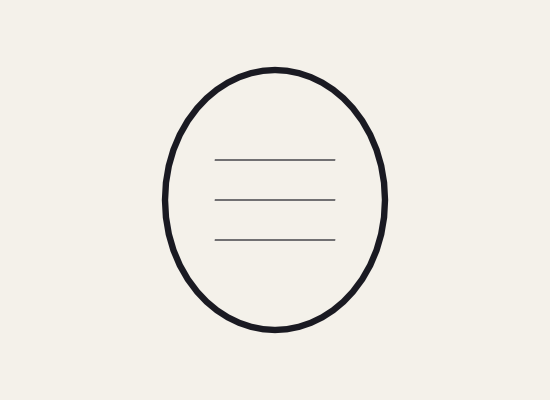 |  |  |
| *One press thinner: interior lines preserved* | *Original drawing as inked* | *One press thicker: heavy contour enhanced* |

### 4.2 Expand Fill (`Modify ▸ Shape ▸ Expand Fill`)
- **Functionality:** Insets or outsets vector fill boundaries by a specified pixel distance.
- **Corner Fillet Controls:** Miter (sharp corners), Round (smooth arc fillet), and Bevel (flattened corner chamfer).
- **Production Use Case:** Creating uniform character contour shadows, insetting highlights, expanding painted fills under ink outlines to guarantee zero render seams.

### 4.3 Convert Lines to Fills (`Modify ▸ Shape ▸ Convert Lines to Fills`)
- **Functionality:** Converts linear vector stroke paths into closed polygon ribbon fills.
- **Production Use Case:** Applying complex gradients across stroke thicknesses, or using the Eraser tool (`E`) to carve tapered variable-width tips into previously uniform marker strokes.

### 4.4 Recognise Shape (`Modify ▸ Shape ▸ Recognise Shape`)
- **Functionality:** Mathematical geometric recognizer that converts wobbly hand-drawn sketches into perfect circles, rounded rectangles, or straight linear vectors while maintaining scale and orientation.

### 4.5 Extend Part Under Neighbours (`Modify ▸ Rig ▸ Extend Part`)
- **Functionality:** Analyzes character rig limb symbol boundaries and automatically extrudes the vector artwork underneath overlapping joint caps to the transformation pivot point on an isolated "Extension" layer.
- **Production Use Case:** Eliminates unsightly joint gaps and disconnections when limbs bend past 45° in cut-out puppets.

---

## 5. Advanced Brush Engines & The 15 Procedural Scenery Brushes

### 5.1 The 7 Core Brush Engines (`Toolbar ▸ Brush ▸ Tool Options`)
1. **Fluid Brush:** Dynamic velocity-sensitive stroke engine. Stroke width thins down during rapid acceleration flicks and fattens during slow, deliberated drags. Designed for Japanese anime ink lines and calligraphy.
2. **Normal Brush:** Uniform-width vector marker stroke with customizable entry/exit taper percentages.
3. **Pattern Brush:** Replicates vector master stamps repeatedly along the drawn spline at set spacing intervals. Includes built-in patterns (Dot, Dash, Leaf, Star, Arrow, Diamond) and user selections.
4. **Art Brush:** Stretches a single master vector silhouette non-linearly along the entire path length from start to end anchor.
5. **Soft Brush:** Hybrid raster airbrush engine that renders soft-edge glowing gaussian strokes alongside vector artwork on the same layer.
6. **Effect Brush:** Procedural atmospheric and architectural painter that lays down composite silhouettes, particle arrays, and gradient glows in a single drag gesture.
7. **Wave Brush:** Procedural animated stroke engine for water, smoke, and hair. Automatically increments its internal mathematical wave phase across consecutive timeline frames, producing continuous flowing motion with zero hand keyframing.

### 5.2 The 15 Procedural Effect Brushes (`Brush ▸ Effect ▸ Kind`)

| Brush Kind | Output of Single Drag Gesture | Fill Color Role | Animation Video Use Case |
|---|---|---|---|
| **Snow** | Randomly scattered drifting crystalline flakes along path | Flake color | Winter blizzard shots, holiday specials |
| **Rain** | Slanted high-velocity streaks of precipitation | Streak color | Dramatic stormy dialogue sequences |
| **Stars** | Dense star field with 4-point sparkle crosshairs | Star twinkle color | Night skies, cosmic sci-fi backgrounds |
| **Fireflies** | Warm glowing points with radial luminance halos | Core glow color | Enchanted forest scenes, summer evenings |
| **Bokeh** | Soft out-of-focus overlapping optical discs | Disc tint | Romantic close-ups, shallow depth-of-field |
| **Clouds** | Soft billowing cumulus volumes along stroke | Cloud shading | Skies, establishing landscape shots |
| **Diffused Light** | Broad airbrushed soft volumetric lighting wash | Light color | Atmospheric room ambience, god rays |
| **Light Rays** | Prismatic beams fanning out from start to end | Beam color | Sun bursting through windows or treetops |
| **Moonlight** | Luminous lunar disc deposited at stroke termination | Moon core light | Night exterior establishing shots |
| **String Lights** | Festive hanging wires with cycling colored bulbs | Bulb cycle palette | Street festivals, cozy interior room decor |
| **Lamps** | Victorian street lamps with downward cast cones | Lamp light pool | Film noir streets, moody night walks |
| **Buildings** | Detailed city skyline with warm glowing windows | Silhouette color | Urban backdrops, cyberpunk city vistas |
| **Pine Trees** | Dense coniferous treeline of evergreen pines | Treeline silhouette | Forest chases, mountain ridge environments |
| **Leafy Trees** | Round-crowned deciduous canopy treeline | Canopy silhouette | Park scenes, suburban backyard environments |
| **Grass** | Irregular blades of grass sprouting upward from path | Blade silhouette | Foreground ground plane dressing |

### 5.3 Procedural Scenery Snapshots

| Bare Staging | Forest Environment | City Skyline |
|:---:|:---:|:---:|
| 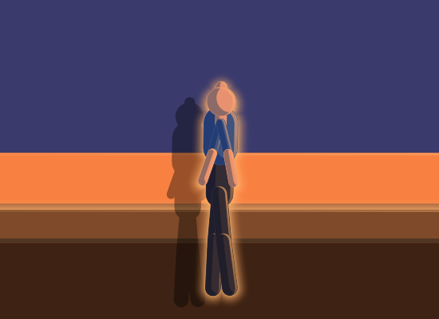 | 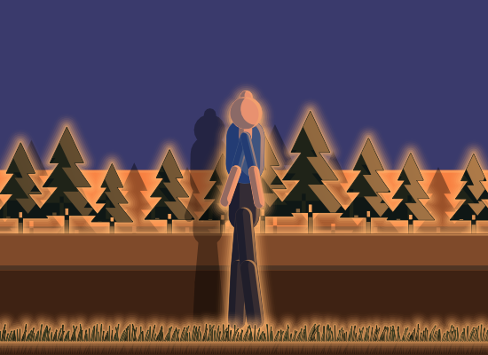 |  |
| *Ground and sky staging only* | *Dense pine treeline and foreground grass* | *Lit skyline with glowing windows and street lamps* |

---

## 6. Timeline Mastery, Frame Sequencer & Cadence Automation

### 6.1 Master Keyframe & Span Operation Matrix

| Operation | Breadcrumb Path | Hotkey | Technical Behavior & Production Impact |
|---|---|:---:|---|
| **Insert Frame** | `Insert ▸ Timeline ▸ Frame` | `F5` | Extends exposure duration of preceding keyframe drawing by 1 frame. Does not create new drawing data. |
| **Remove Frame** | `Modify ▸ Timeline ▸ Remove Frames` | `Shift + F5` | Deletes the targeted frame cell, contracting the layer timeline duration by 1 frame. |
| **Insert Keyframe** | `Insert ▸ Timeline ▸ Keyframe` | `F6` | Clones artwork from preceding frame into a new independent keyframe cell ready for modification. |
| **Clear Keyframe** | `Modify ▸ Timeline ▸ Clear Keyframe` | `Shift + F6` | Reverts a keyframe into an extended exposure span, inheriting the artwork of the prior keyframe. |
| **Insert Blank Keyframe** | `Insert ▸ Timeline ▸ Blank Keyframe` | `F7` | Instantiates an empty keyframe cell. Erases canvas for that cell, ready for clean drawing passes. |
| **Clear Frames** | `Modify ▸ Timeline ▸ Clear Frames` | `Alt + Backspace` | Empties vector content within selected cell range while strictly preserving timeline cell duration. |
| **Cut Frames** | `Edit ▸ Timeline ▸ Cut Frames` | `Ctrl + Alt + X` | Extracts selected span, keyframes, tweens, and artwork to internal frame clipboard. |
| **Copy Frames** | `Edit ▸ Timeline ▸ Copy Frames` | `Ctrl + Alt + C` | Copies selected span, keyframes, tweens, and artwork to internal frame clipboard. |
| **Paste Frames** | `Edit ▸ Timeline ▸ Paste Frames` | `Ctrl + Alt + V` | Overwrites destination timeline position with buffered frame data. |
| **Reverse Frames** | `Control ▸ Reverse Frames` | Menu | Inverts the chronological order of selected keyframes across the timeline. |
| **Hold on Twos** | `Control ▸ On Twos` | Menu | Converts selected 24fps keyframe span to hold each drawing for exactly 2 frames (12fps traditional cadence). Cuts required in-between drawings by 50%. |
| **Hold on Threes** | `Control ▸ On Threes` | Menu | Converts selected 24fps span to hold each drawing for exactly 3 frames (8fps anime cadence). Cuts required in-between drawings by 66%. |
| **Paint Through** | `Control ▸ Paint Through` | Menu | Automatically scans every subsequent keyframe in the active layer span and flood-fills corresponding vector regions using the current frame's gap-aware bucket fills. Eliminates manual frame-by-frame color painting. |
| **Fit to Narration** | `Commands ▸ Fit to Narration` | Menu | Analyzes voiceover audio waveform, determines sentence silence boundaries (75th percentile energy threshold), expands timeline to exact dialogue length, and drops blank keyframes at the start of every spoken line. |

### 6.2 Move Frames (`MoveFrames { to, rows, copy }`)
- **Drag Interaction:** Animators can drag any rectangular selection of frames across time and layers.
- **Copy Mode:** Holding `Alt` while dragging duplicates the frame blocks rather than translating them.
- **Automation Support:** The frame move operation is represented as a pure data command, allowing the AI assistant to automate complex timeline layout manipulations.

---

## 7. The 7 Layer Architectures, Parenting & Spatial 2.5D Parallax

### 7.1 Detailed Specification of the 7 Layer Types
1. **Normal Layer:** Standard drawing canvas holding merge shapes, object drawings, groups, and symbol instances.
2. **Folder Layer:** Hierarchical organizational container. Supports collapsing and bulk locking/hiding.
3. **Mask Layer:** Alpha/geometric clipping parent. Restricts visibility of nested child layers strictly to the interior contours of shapes residing on the mask layer.
4. **Inverse Mask Layer (BuzzAnimate Proprietary):** Inverts traditional masking mechanics. Geometry drawn on this layer cuts physical transparent windows through underlying child layers, rendering everything *outside* the mask visible and everything *inside* invisible.
   - *Production Use Case:* Cutting bullet holes, open doorways, peering spy holes, and bite marks through complex composite backgrounds without destructive editing.
5. **Masked Layer:** Any child layer indented beneath an active Mask or Inverse Mask layer.
6. **Guide Layer:** Non-renderable drafting layer. Displays reference model sheets, storyboard animatics, or video rotoscope guides. Automatically excluded from final video exports.
7. **Guided Layer:** A timeline layer bound to follow the trajectory of an overarching vector guide curve.

### 7.2 Layer Parenting & Rigless Skeletal Hierarchies
- **Indentation Linking:** Indenting Layer B beneath Layer A creates a hierarchical parent-child transformation link.
- **Transform Inheritance:** Rotating, translating, or scaling Layer A automatically propagates through the transformation matrix of Layer B, preserving relative joint offsets without requiring an explicit bone armature.

### 7.3 Layer Depth & 2.5D Parallax Engine (`Window ▸ Layer Depth`)
- **Cross-Section Viewport:** Displays a spatial side-profile of the stage.
- **Z-Axis Depth Coordinates:** Layers can be assigned explicit depth values ($-\infty < Z < +\infty$).
- **Parallax Math:** The GPU projection matrix automatically computes multiplane parallax shifts during camera panning, dollies, and rotations.

---

## 8. Vector Interpolation Engines & The Motion Graph Editor

### 8.1 The 3 Tween Engines
1. **Classic Tween (`Insert ▸ Create Classic Tween`):** Operates on symbol instances. Interpolates position, rotation, scale, alpha, and color tint across keyframe pairs.
2. **Motion Tween (`Insert ▸ Create Motion Tween`):** Span-based object tweening. Records continuous property changes directly on frames without explicit keyframe creation.
3. **Shape Tween (`Insert ▸ Create Shape Tween`):** Vector morphing engine. Computes shortest-distance point-to-point path morphs between raw, ungrouped Merge Shapes.

### 8.2 The Motion Editor Panel (`Window ▸ Motion Editor`)
- **Cubic Bézier Graph Curves:** Visual graph editor displaying property curves over time.
- **Easing Algorithms:**
  - **Ease In / Ease Out:** Smooth acceleration / deceleration.
  - **Cubic Bounce:** Simulates gravity collisions with decaying rebound oscillations.
  - **Damped Elastic:** Simulates spring tensions with overshoot and settle.

---

## 9. Symbol Architecture, Instance Management & Library Pipeline

### 9.1 Symbol Types & Runtime Execution
- **Graphic Symbol:** Synced 1:1 with the parent timeline. Scrubbable on stage. Mandatory for lip-sync, expressions, and rigged characters.
- **MovieClip Symbol:** Self-contained independent timeline loop. Runs continuously regardless of main stage playback state.
- **Button Symbol:** Interactive 4-state container: `[Up]`, `[Over]`, `[Down]`, `[Hit]`.

### 9.2 Symbol Management Commands
- **Convert Selection to Symbol:** Press `F8` | Assigns name, archetype, and registration point.
- **Create Blank Symbol:** Press `Ctrl + F8` | Opens empty symbol timeline.
- **Edit Symbol in Place:** Select instance and press `Ctrl + E` (or double-click) | Dims surrounding scene; focuses symbol timeline.
- **Exit Symbol:** Press `Ctrl + F4` (or double-click empty pasteboard) | Returns to root document.
- **Swap Symbol (`Modify ▸ Swap Symbol`):** Replaces selected on-stage instance with another library symbol, preserving all timeline position, scale, rotation, and color effects.
- **Break Apart (`Ctrl + B`):** Deconstructs symbols or text into raw editable vector merge shapes.

---

## 10. Character Rigging, FABRIK Inverse Kinematics & Mesh Warping

### 10.1 The FABRIK Inverse Kinematics Engine (`Window ▸ Rigging`)
- **Mathematical Operation:** Forward And Backward Reaching Inverse Kinematics. Iterates backwards from target effector to root, then forwards from root to effector until reaching convergence tolerance ($\Delta < 0.01\,\text{px}$) in sub-millisecond calculation times.
- **Joint Limits:** Configurable angular boundaries (e.g., knee joint restricted to $[0^\circ, 150^\circ]$).
- **Pin Constraints:** Anchors joint positions (e.g., foot pinned to ground plane during crouch).

### 10.2 The Pose Library
- **Save Pose:** Stores joint angular states into named library assets.
- **Mirror Pose:** Inverts left and right limb transform data across the sagittal plane.
- **Pose-to-Pose Interpolation:** Computes shortest-arc angular quaternions to tween between library poses across keyframes.

---

## 11. Studio Vector Lighting & Real-Time Shadow Synthesis

### 11.1 The 5 Vector Light Types (`Window ▸ Lighting`)

```
┌───────────┬─────────────────────────────────────────────────────────────────┐
│ Light     │ Optical Characteristics & Vector Shadow Behavior                │
├───────────┼─────────────────────────────────────────────────────────────────┤
│ 1. Sun    │ Directional parallel rays across the entire stage. Aimed via an │
│           │ intuitive 360° celestial orbital compass dial.                  │
├───────────┼─────────────────────────────────────────────────────────────────┤
│ 2. Sky    │ Hemispherical ambient fill illumination with zero hard shadows. │
├───────────┼─────────────────────────────────────────────────────────────────┤
│ 3. Lamp   │ Point light source with origin coordinate, radius falloff, and  │
│           │ smooth inverse-quadratic illumination decay.                    │
├───────────┼─────────────────────────────────────────────────────────────────┤
│ 4. Gloom  │ Theatrical negative light primitive. Subtracts luminance values │
│           │ to cast deep artistic shadows into stage corners.               │
├───────────┼─────────────────────────────────────────────────────────────────┤
│ 5. Fire   │ Dynamic stochastic light source. Automatically flickers warm    │
│           │ orange/yellow intensity and shadow length across frames.        │
└───────────┴─────────────────────────────────────────────────────────────────┘
```

### 11.2 Real-Time Vector Cast Shadows
- **Gizmo Toggle:** Press `Ctrl + Shift + L` to show/hide stage light manipulation handles.
- **Shadow Projection Targets:**
  - **Ground:** Projects elongated vector shadow hulls extending from character feet across the floor plane.
  - **Wall:** Casts an upright silhouette shadow directly behind the character onto vertical background surfaces.
- **Edge Modeling Modes:**
  - **Figure:** Generates unified silhouette shading across complex grouped character rigs.
  - **Shapes:** Measures highlights and shadow terminators across each individual vector shape.
  - **Off:** Disables rim bands while retaining overall tonal illumination and cast shadows.
- **Highlight Screen Blending:** Highlights do not replace colors with flat white; they screen light tones over base colors, preserving garment saturation.

---

## 12. Vector Filters, Blend Modes & Procedural Live Motion Modifiers

### 12.1 Vector Filters (`Window ▸ Filters`)
- **Blur:** Multi-pass separable Gaussian blur (independent X/Y radii).
- **Drop Shadow:** Vector shadow projection with Distance, Angle, Color, Blur, Strength, Knockout, and Inner Shadow options.
- **Glow:** Radial luminous boundary glow with Inner Glow and Knockout capabilities.
- **Bevel:** Simulates chiseled 3D light edges with Inner, Outer, and Full bevel configurations.
- **Adjust Color:** Real-time matrix transforms for Hue Rotation ($-180^\circ \dots +180^\circ$), Saturation, Brightness, and Contrast.

### 12.2 The 10 Layer Blend Modes
`Normal`, `Layer`, `Darken`, `Multiply`, `Lighten`, `Screen`, `Overlay`, `Hard Light`, `Add`, and `Difference`.

### 12.3 Procedural Live Motion Modifiers (With Visual Proofs)

#### Cylindrical Head Turn Modifier (`Filters ▸ Live Motion ▸ + ▸ Turn`)
Sweeps facial features across an imaginary 3D cylinder via `rotationY` without redrawing:

| Turned Left | Three-Quarter Left | Front Master Drawing | Three-Quarter Right | Turned Right |
|:---:|:---:|:---:|:---:|:---:|
| 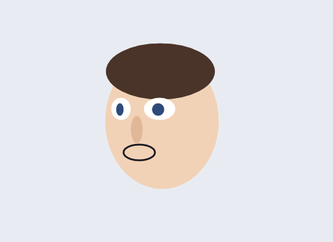 | 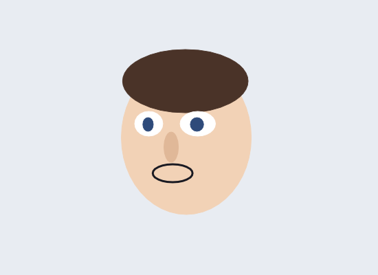 | 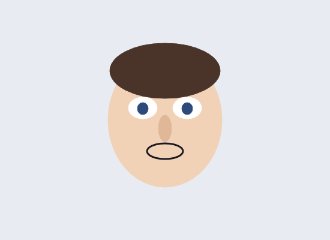 | 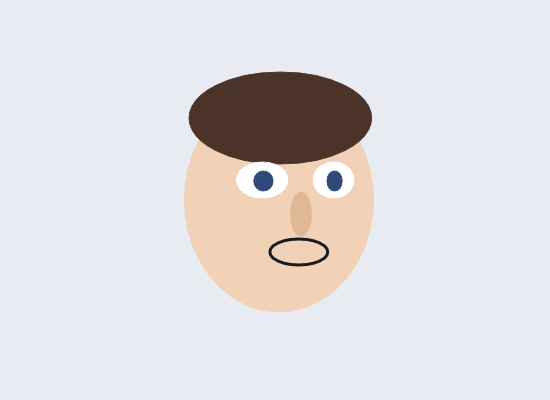 | 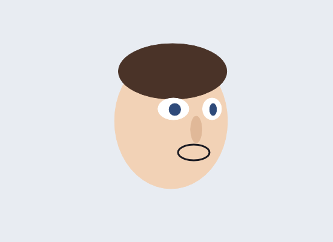 |
| *$-45^\circ$ Yaw: Far eye foreshortened* | *$-22^\circ$ Yaw: Mid turn* | *Only this front view was drawn!* | *$+22^\circ$ Yaw: Natural drift* | *$+45^\circ$ Yaw: Features wrap around skull* |

#### Procedural Eyelid Blink Modifier (`Filters ▸ Live Motion ▸ + ▸ Blink`)
Biological eyelid drop (0.16s) with jittered double-blinks and anchored bottom contour:

| Open State | Mid-Blink State |
|:---:|:---:|
|  | 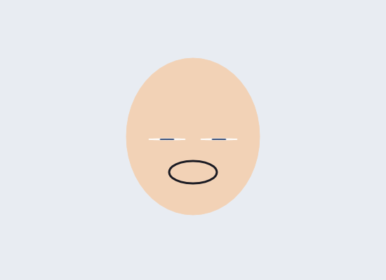 |
| *Natural alert gaze* | *Lid drops to lower eye contour; avoids wincing artifact* |

---

## 13. Cinematic 3D Spatial Camera System

### 13.1 The 6 Named Cinematic Camera Moves (`Menu ▸ Camera ▸ Move`)

| Move | Opening Master Frame | Resulting Move Frame |
|---|:---:|:---:|
| **Push In** | 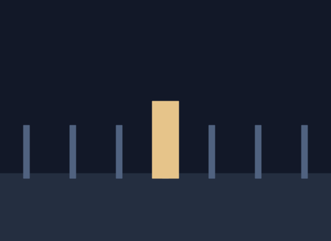 | 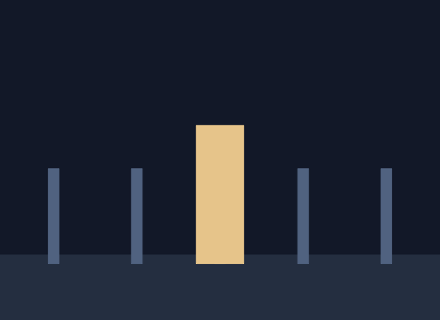 |
| **Pull Out** |  | 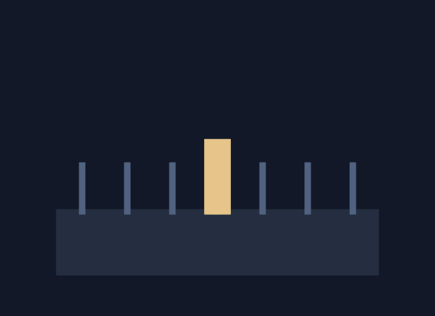 |
| **Pan Left** |  | 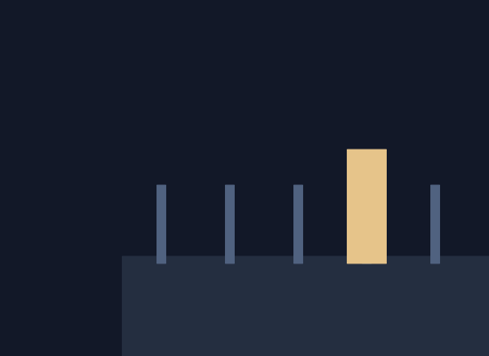 |
| **Pan Right** |  | 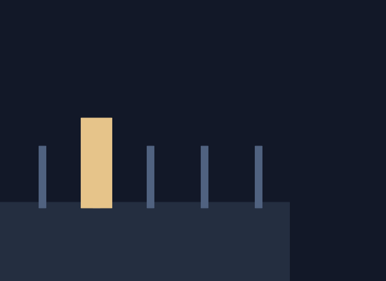 |
| **Drift** |  | 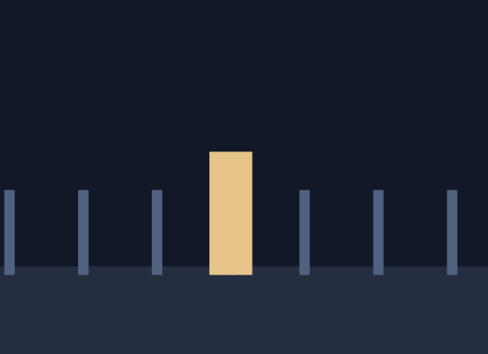 |

### 13.2 Camera Easing Curve Proofs

| Linear Camera Move (Artificial / Jarring) | Smoothly Eased Camera Move (Cinematic / Natural) |
|:---:|:---:|
| 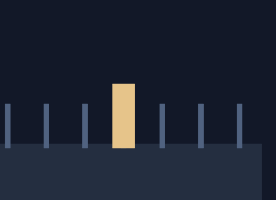 |  |
| *Moves at full velocity instantly; abrupt stop* | *Gradual acceleration and cushioned deceleration* |

---

## 14. Audio Decoders, Subtitle Parsing & Automated Lip-Sync

### 14.1 Subtitle & Dialogue Pipeline
- **SRT Caption Import:** `Commands ▸ Import Captions (.srt)…`
- **Visual Proof:** Frame-synchronized dialogue captions displayed directly over animation artwork:

<p align="center">
  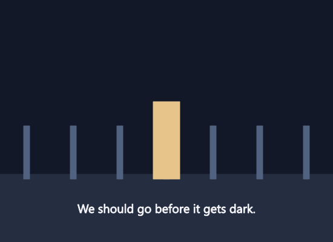
  <br><em>Figure 14.1: Synchronized subtitle captions keyed from voiceover tracks with speaker attribution.</em>
</p>

### 14.2 Automated Lip-Sync from Captions (`Commands ▸ Lip Sync from Captions`)
- Routes spoken audio lines strictly to the designated character's mouth symbol.
- Automatically holds mouth in closed resting position when the character is not speaking.
- Generates 10 Preston Blair visemes (`Rest`, `Ai`, `E`, `O`, `U`, `L`, `WQ`, `MBP`, `FV`, `Etc`) pre-configured inside character Graphic symbols.

---

## 15. Automated Staging, Procedural Direction & Acting Engine (`buzz-act`)

### 15.1 Procedural Acting Actions (`Insert ▸ Scene ▸ Perform…`)

#### The "Sit" Action Performance
<p align="center">
  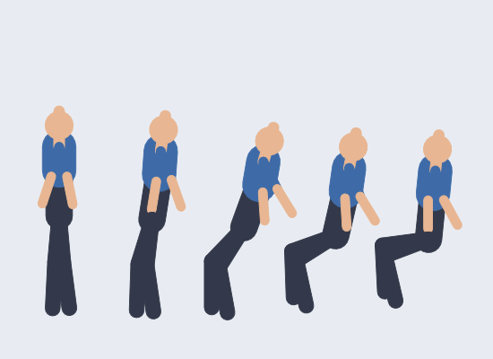
  <br><em>Figure 15.1: Five stages of the procedural "Sit" action: forward lean, knee flexion, hip descent, and weighted settle.</em>
</p>

#### The "Point" Action Performance
<p align="center">
  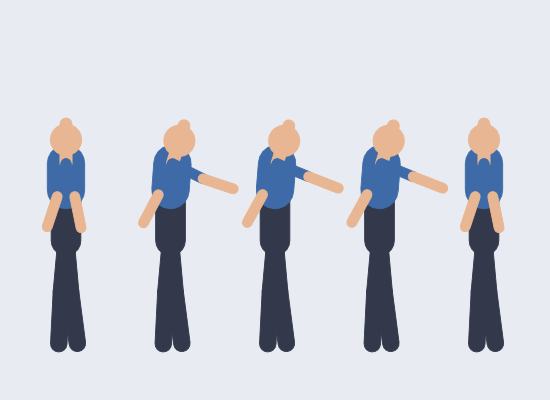
  <br><em>Figure 15.2: Five stages of the procedural "Point" action: arm ascent, elbow extension, readable hold, and return.</em>
</p>

#### The "Turn" and "React" Action Performances
<p align="center">
  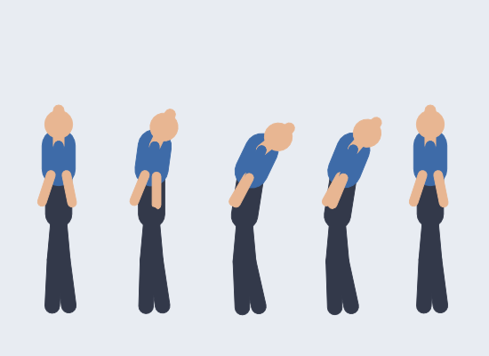
  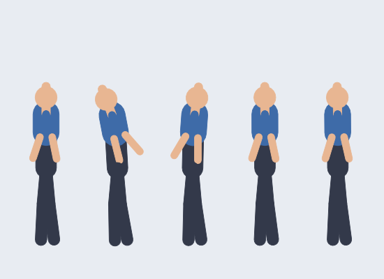
  <br><em>Figure 15.3: Procedural Turn (head-lead body rotation) and React (sharp recoil and flinch).</em>
</p>

---

## 16. The Sequence Strip, Master Audio & Multi-Shot Directing

### 16.1 Sequence Strip Architecture
- **Master Audio Waveform:** Anchors the entire film soundtrack across the bottom timeline strip.
- **Multi-Shot Breakdown:** Divides production into distinct shot blocks spanning master audio timecodes.
- **Cut on Dialogue (`CutOnDialogue`):** Proposes exactly one shot per spoken dialogue sentence, assigning corresponding camera setups automatically.
- **Split at Playhead (`SplitAtPlayhead`, Hotkey: `S`):** Non-destructively splits a shot into two independent scenes without disturbing playback continuity.
- **Continue from Shot (`ContinueFromShot`):** Seeds a new shot with the exact character poses and positions from the terminal frame of an earlier shot.

---

## 17. Integrated Local AI Studio & Vision Pipeline (`buzz-ai`)

- **Breadcrumb Path:** `Window ▸ AI` | Hotkey: `Ctrl + Alt + I`

### 17.1 Character from Image & Auto-Rig Pipeline
Converts a single raster concept illustration into a segmented, occluded-part-completed, vector-traced, colored, and rigged armature in under 10 seconds:

<p align="center">
  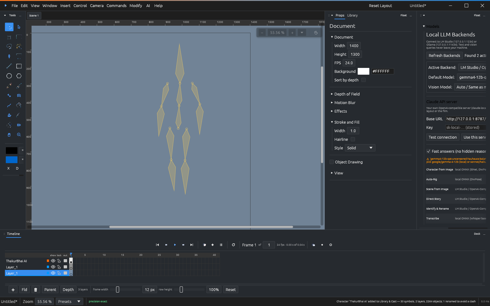
  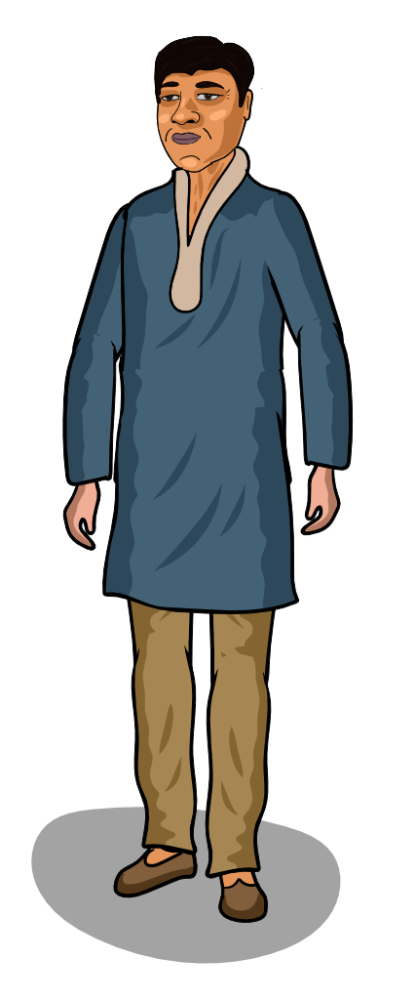
  <br><em>Figure 17.1: Left: AI Character from Image panel. Right: Input raster character illustration.</em>
</p>

<p align="center">
  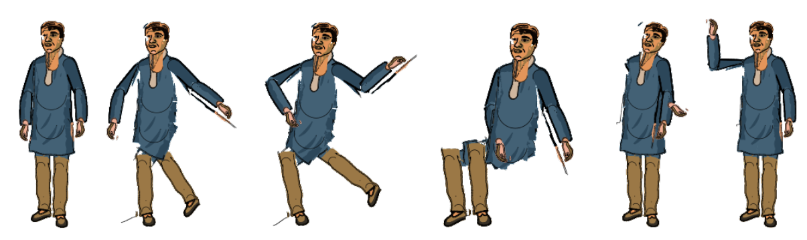
  <br><em>Figure 17.2: Generated vector character pose sheet (Rest, Walk, Run, Sit, Wave, Point) with intact facial features.</em>
</p>

<p align="center">
  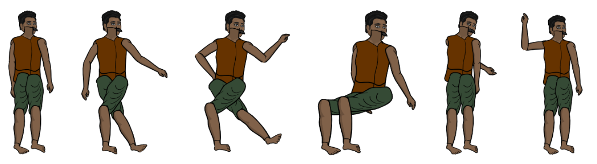
  <br><em>Figure 17.3: Automated skeleton detection via DWPose and layer-slot binding across poses.</em>
</p>

### 17.2 Scene from Image & Semantic Reconstruction Pipeline
Reconstructs an entire animated stage scene from a reference concept image using SigLIP visual embeddings:

<p align="center">
  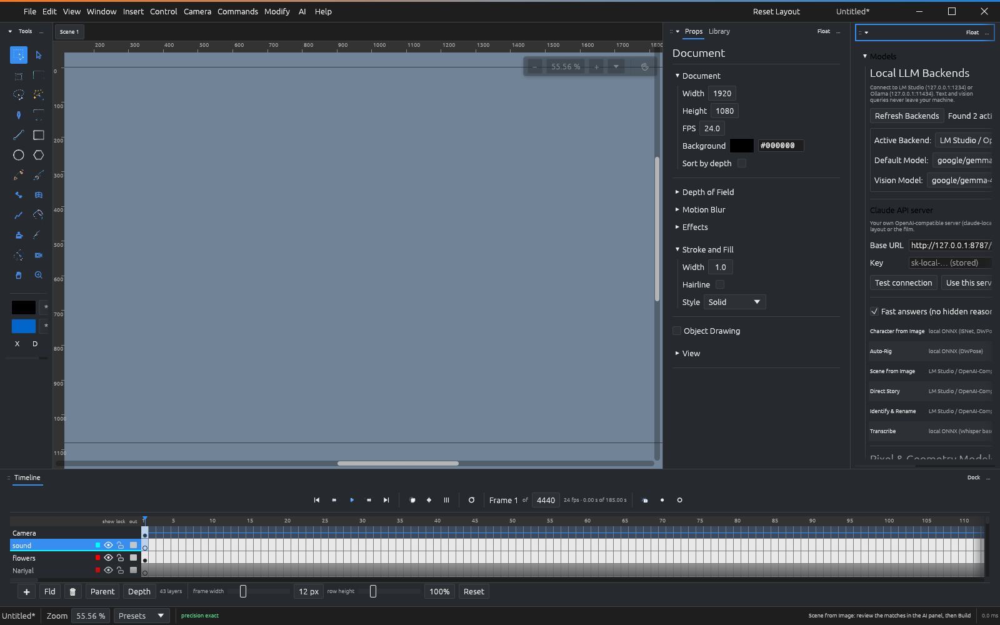
  <br><em>Figure 17.4: AI Scene from Image configuration panel with candidate symbol matching.</em>
</p>

| Reference Concept Image | Rebuilt BuzzAnimate Scene |
|:---:|:---:|
| 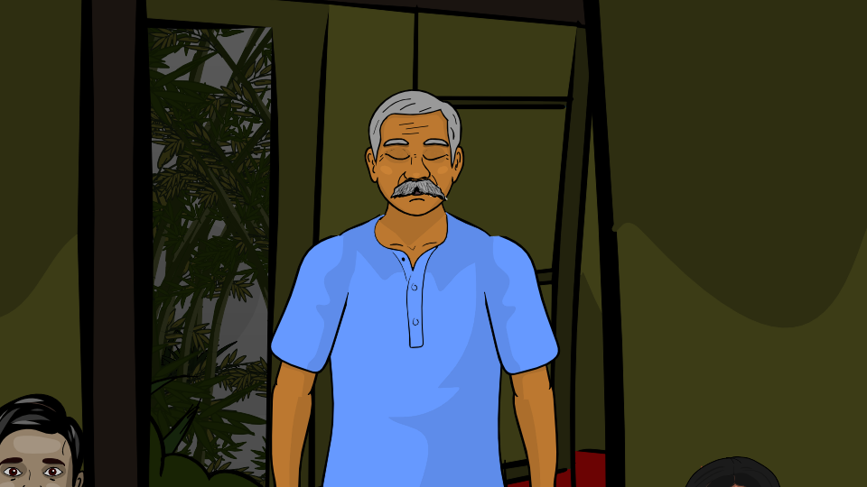 | 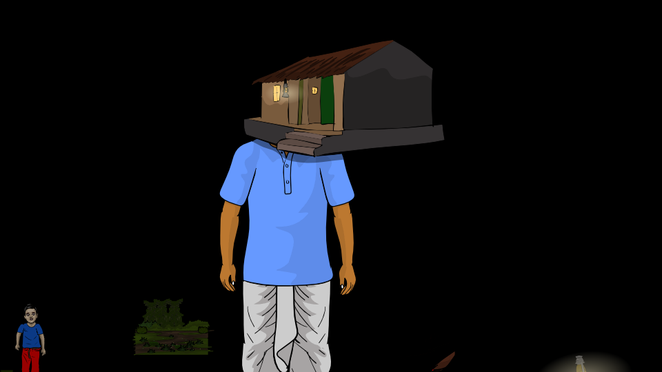 |
| *Input background concept illustration* | *Automatically staged vector assets, character rigs, and ground planes* |

### 17.3 Direct Story & Story Strip Pipeline
Transforms natural language screenplays into timed shots and blocked performances:

<p align="center">
  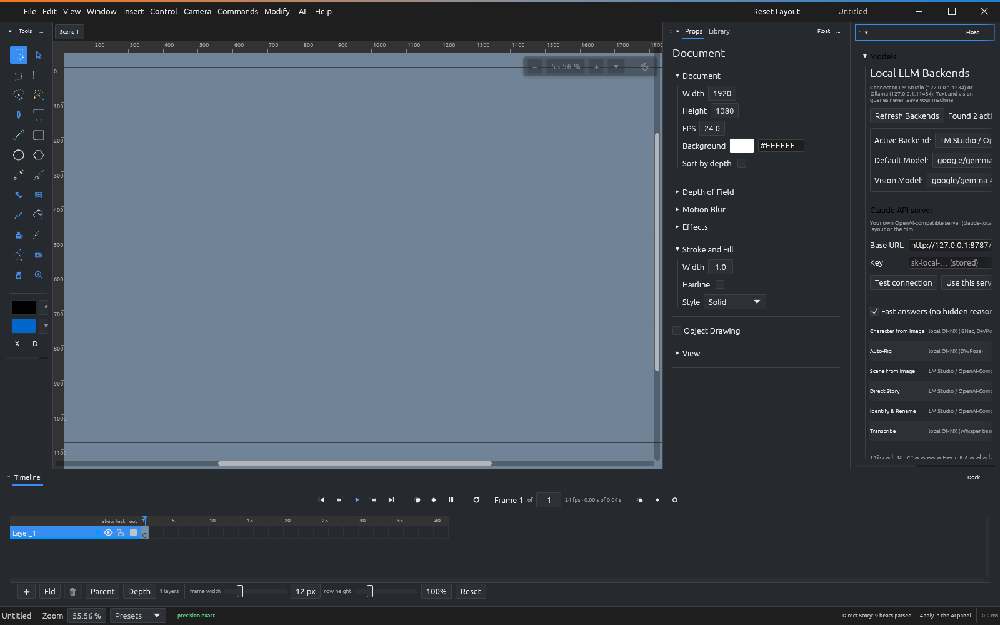
  <br><em>Figure 17.5: AI Story Director panel showing screenplay breakdown, beat scheduler, and cast roster.</em>
</p>

<p align="center">
  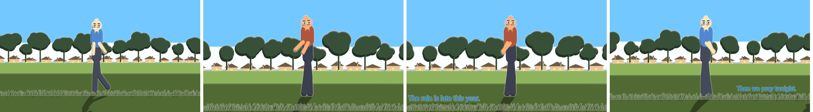
  <br><em>Figure 17.6: Storyboard film strip generated across multiple camera shots with character acting and dialogue.</em>
</p>

---

## 18. Bitmap-to-Vector Tracing Pipeline

- **Breadcrumb Path:** `Menu ▸ Modify ▸ Bitmap`

| Raw Grainy Bitmap Scan | Traced as Line Art | Traced as Multi-Color Vector |
|:---:|:---:|:---:|
| 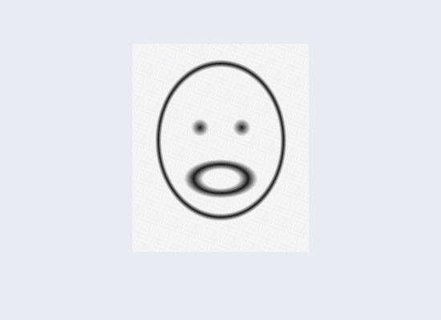 |  | 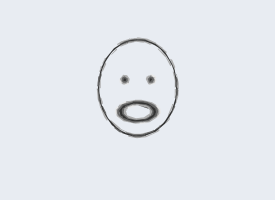 |
| *Anti-aliased, noisy raster doodle* | *Paper pixels discarded; closed vector outlines ready for Paint Bucket* | *Quantized 6-color vector fills with background preserved* |

---

## 19. The Automated Episode Producer Engine (`ProduceEpisode`)

- **Breadcrumb Path:** `File ▸ Produce Episode…`
- **End-to-End Automated Pipeline:**
  1. Ingests raw screenplay script (`.txt`, `.pdf`, `.fountain`).
  2. Ingests character reference art and master voiceover audio track.
  3. Executes natural language breakdown: scenes, shots, dialogue lines, and cast assignment.
  4. Builds environment sets using procedural scenery brushes and lighting rigs.
  5. Transcribes dialogue with local Whisper AI into timed SRT cues.
  6. Automatically rigs character cast members and routes mouth visemes to dialogue.
  7. Directs camera tracking, pans, dollies, and character acting beats.
  8. Automatically exports final 4K video overnight without user intervention.

---

## 20. Import, Export & Headless CLI Production Engine

### 20.1 Import Matrix
- **Projects:** Adobe Animate `.xfl` (uncompressed directory) and `.fla` archives.
- **Vector Assets:** Legacy Flash `.swf`, Adobe Illustrator `.ai`, Vector `.pdf`, and `.svg`.
- **Media:** Raster images (PNG, JPEG, WebP), Audio (WAV, MP3, OGG, FLAC), and Video reference layers.

### 20.2 Export Matrix
- **Master Video:** Hardware GPU NVENC encoding (`h264_nvenc`, `hevc_nvenc`, `av1_nvenc`) with CPU fallback. Muxes timeline audio automatically.
- **ProRes 4444 (.mov):** Broadcast-quality video preserving full 8-bit alpha transparency for post-production compositing in DaVinci Resolve or After Effects.
- **Web Media:** Optimized animated GIF and animated WebP with palette dithering.
- **Production Sequences:** Numbered PNG frames (`frame_0001.png`) and SVG vector sequences.
- **Round-Trip Interchange:** Exports directly back to Adobe Animate `.fla` project files.

### 20.3 Headless CLI Production Engine
```bash
# Render a story brief directly to 4K MP4 video using discrete GPU
buzzanimate --brief story.txt --render film.mp4 --height 2160 --gpu NVIDIA

# Add scripted shots to an existing project and render ProRes 4444 with alpha
buzzanimate project.buzz --brief new_scenes.txt --render output.mov
```

---

## 21. ECMAScript / JSFL Scripting & Automation Engine

- **Breadcrumb Path:** `Window ▸ Actions` | Hotkey: `F9` | Run Script: `Ctrl + Enter`
- **Technical Operation:**
  - Sandboxed QuickJS ECMAScript runtime.
  - Implements the complete industry-standard `fl.*` and `document.*` API surface.

```javascript
// Industrial Batch Generator Script Example
var doc = fl.getDocumentDOM();
var timeline = doc.getTimeline();

fl.trace("Executing batch staging for: " + doc.name);
timeline.addNewLayer("Generated_Environment");

// Procedurally generate a 12-column architectural pillar hall
for (var i = 0; i < 12; i++) {
    doc.addNewRectangle({
        left: 100 + (i * 140),
        top: 200,
        right: 180 + (i * 140),
        bottom: 800
    }, 0);
}
fl.trace("Pillar staging completed successfully.");
```

---

## 22. Workspace Docking, Command Palette, Layout Locking & Themes

- **Docking Architecture:** Every panel can be docked to Left, Right, Bottom, or torn off as an independent floating OS window.
- **Layout Locking:** Press `Ctrl + Alt + L` to lock all panel dividers and dock borders, preventing accidental layout shifts during stylus drawing.
- **Reset Workspace:** `Window ▸ Reset Layout` restores factory default docking configurations.
- **Command Palette:** Press `Ctrl + K` to open an instant spotlight search bar. Type any tool, menu command, or action and press `Enter` to execute immediately.
- **Interface Themes:** Toggle between **Studio Dark** (low-eye-strain studio theme) and **Paper Light** via `Window ▸ Light Interface`.

---

## 23. Exhaustive Master Keyboard Shortcuts & Command Index

### 23.1 Single-Key Tool Shortcuts
| Key | Tool | Key | Tool | Key | Tool |
|:---:|---|:---:|---|:---:|---|
| **`V`** | Selection | **`Q`** | Free Transform | **`K`** | Paint Bucket |
| **`A`** | Subselection | **`P`** | Pen | **`S`** | Ink Bottle |
| **`L`** | Lasso | **`T`** | Text | **`I`** | Eyedropper |
| **`G`** | Magic Wand | **`N`** | Line | **`E`** | Eraser |
| **`Y`** | Pencil | **`R`** | Rectangle | **`C`** | Camera |
| **`B`** | Brush | **`O`** | Oval | **`H`** | Hand (Pan) |
| **`M`** | Bone (Rigging) | **`W`** | Asset Warp | **`Z`** | Zoom |
| **`J`** | Motion Path / Toggle Object Drawing | **`[`** | Thin Lines | **`]`** | Thicken Lines |

### 23.2 Timeline & Animation Shortcuts
| Shortcut | Action | Shortcut | Action |
|---|---|---|---|
| **`F5`** | Insert Frame (Extend) | **`Shift + F5`** | Remove Frame |
| **`F6`** | Insert Keyframe (Clone) | **`Shift + F6`** | Clear Keyframe |
| **`F7`** | Insert Blank Keyframe | **`Alt + Backspace`** | Clear Frames (Empty Content) |
| **`Ctrl + Alt + X`** | Cut Frames | **`Ctrl + Alt + C`** | Copy Frames |
| **`Ctrl + Alt + V`** | Paste Frames | **`Alt + Shift + O`** | Toggle Onion Skinning |
| **`Enter`** | Play / Pause Playback | **`.` (Period)** | Step 1 Frame Forward |
| **`,` (Comma)** | Step 1 Frame Backward | **`Home` / `End`** | Jump to First / Last Frame |

### 23.3 Object, Selection & Symbol Operations
| Shortcut | Action | Shortcut | Action |
|---|---|---|---|
| **`Ctrl + Z`** | Undo | **`Ctrl + Shift + Z` / `Ctrl + Y`** | Redo |
| **`Ctrl + X` / `C` / `V`** | Cut / Copy / Paste | **`Ctrl + Shift + V`** | Paste in Place |
| **`Ctrl + D`** | Duplicate Selection | **`Ctrl + A` / `Ctrl + Shift + A`** | Select All / Deselect All |
| **`Ctrl + G`** | Group Selection | **`Ctrl + Shift + G`** | Ungroup Selection |
| **`Ctrl + B`** | Break Apart (Shapes/Text) | **`F8`** | Convert Selection to Symbol |
| **`Ctrl + F8`** | Create New Blank Symbol | **`Ctrl + E`** | Edit Symbol in Place |
| **`Ctrl + F4`** | Exit Symbol to Document | **`Arrow Keys` / `Shift+Arrows`** | Nudge 1px / Nudge 8px |

### 23.4 View, Stage & Inspection Shortcuts
| Shortcut | Action | Shortcut | Action |
|---|---|---|---|
| **`Ctrl + K`** | Open Command Palette | **`Ctrl + Alt + I`** | Open AI Studio Panel |
| **`Ctrl + 1`** | 100% Actual Size Zoom | **`Ctrl + 2`** | Show Frame (Fit Stage) |
| **`Ctrl + 3`** | Fit in Window | **`Ctrl + Shift + W`** | Show All Objects |
| **`Ctrl + Shift + L`** | Toggle Stage Light Gizmos | **`Ctrl + Alt + L`** | Lock / Unlock Layout |
| **`F9`** | Actions Panel (Scripting) | **`Ctrl + Enter`** | Run Script (in Actions) |
| **`Ctrl + Alt + Shift + R`** | Toggle Stage Rulers | **`Ctrl + '`** | Toggle Grid Display |
| **`Ctrl + ;`** | Toggle Snapping Guides | **`Ctrl + Shift + U`** | Toggle Object Snapping |

---

*End of Enterprise Product Functionality & Technical Specification Manual.*
